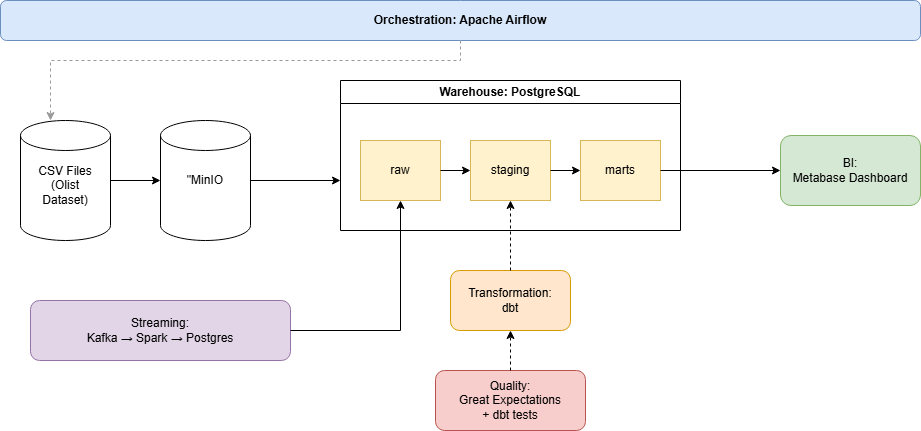

# E-commerce Data Platform

[](https://github.com/abiralpokhrel-learns/ecommerce-data-platform/actions/workflows/ci.yml)

End-to-end data engineering pipeline using the modern data stack. Runs entirely on a local machine with Docker. Zero cloud cost.

Built with the Olist Brazilian E-commerce dataset (~100k orders, 9 related tables) to demonstrate ingestion, lake storage, dimensional modeling, orchestration, data quality, streaming, and BI.



## What this project does

- Ingests raw e-commerce CSVs into a MinIO data lake
- Loads them into a PostgreSQL analytical warehouse
- Models the data into a star schema using dbt (4 fact tables, 5 dimensions)
- Validates quality with dbt tests and Great Expectations
- Orchestrates the pipeline with Apache Airflow
- Streams simulated order events through Kafka and Spark Structured Streaming
- Serves business questions through a Metabase dashboard

## Tech stack

| Layer | Tool | Why |
|---|---|---|
| Containerization | Docker Compose | One-command local environment |
| Object storage | MinIO | S3-compatible local data lake |
| Warehouse | PostgreSQL 15 | SQL-standard analytical database |
| Orchestration | Apache Airflow 2.8 | Industry-standard scheduler |
| Transformation | dbt-core 1.7 | Modern transformation framework |
| Quality | Great Expectations + dbt tests | Two-layer validation |
| Streaming | Kafka 7.5 + Spark 3.5 | Real-time event aggregation |
| BI | Metabase | Free, fast dashboards |
| CI/CD | GitHub Actions | Automated lint and validation |
| Language | Python 3.11 | Ingestion scripts and DAGs |

## Quick start

```bash
git clone https://github.com/abiralpokhrel-learns/ecommerce-data-platform.git
cd ecommerce-data-platform
cp .env.example .env

# Download the Olist dataset from Kaggle and place CSVs in data/raw/
# https://www.kaggle.com/datasets/olistbr/brazilian-ecommerce

docker-compose up -d
```

Wait 60-90 seconds for all containers to become healthy, then:

- **Airflow:** http://localhost:8080 (admin / admin) — trigger the `ingest_olist_daily` DAG
- **Metabase:** http://localhost:3000 — connect to `postgres-warehouse` and view the dashboard
- **MinIO Console:** http://localhost:9001 (minioadmin / minioadmin)
- **Kafka UI:** http://localhost:8090
- **Spark UI:** http://localhost:8081

To run the streaming pipeline:

```bash
# Terminal 1 — produce simulated order events
python streaming/order_producer.py

# Terminal 2 — consume and aggregate with Spark
docker exec -it spark spark-submit --master spark://spark:7077 --packages org.apache.spark:spark-sql-kafka-0-10_2.12:3.5.0,org.postgresql:postgresql:42.7.1 /opt/streaming/spark_consumer.py
```

## Data model

The warehouse uses a star schema in PostgreSQL:

```
                    dim_dates
                        |
   dim_customers --- fct_orders --- dim_products
                        |
                    dim_sellers
```

**Fact tables**

| Table | Grain |
|---|---|
| `fct_orders` | One row per order |
| `fct_order_items` | One row per order line item |

**Dimension tables**

| Table | Description |
|---|---|
| `dim_customers` | Deduplicated by `customer_unique_id` (since `customer_id` is per-order) |
| `dim_products` | Product catalog with English category names |
| `dim_sellers` | Seller master data with geo |
| `dim_dates` | Date spine generated via `dbt_utils.date_spine` |

**Layer separation**

- `raw` schema — untouched ingested data with audit columns
- `staging` schema — type-cast, cleaned, deduplicated views (one per source)
- `marts` schema — analytical tables (facts and dimensions)

## Dashboard

The Metabase dashboard answers core business questions:

- Monthly revenue trend
- Top product categories by revenue
- Geographic distribution of customers (by state)
- Average delivery time by state
- Review score distribution
- Correlation between delivery delays and review scores
- RFM customer segmentation (Champions, Loyal, At Risk, etc.)


## Data quality

Two layers of testing:

**dbt tests** (in `models/**/schema.yml` and `tests/`)
- Uniqueness on all primary and surrogate keys
- Foreign key relationships across the star schema
- Accepted values on categorical columns (e.g., `order_status`)
- Custom singular tests (no negative revenue, delivery after purchase, valid review scores)

**Great Expectations** (in `great_expectations/`)
- Row count bounds on raw tables
- Null rate checks
- Column distribution profiling
- Auto-generated HTML data docs site

## Repository structure

```
ecommerce-data-platform/
├── airflow/              # DAG definitions
│   └── dags/
├── data/
│   └── raw/              # Source CSVs (gitignored)
├── dbt/
│   └── olist/            # dbt project
│       ├── models/
│       │   ├── staging/  # Cleaned views
│       │   └── marts/    # Star schema
│       ├── tests/
│       └── macros/
├── docker/               # Custom Airflow image
├── docs/                 # Architecture diagram, screenshots
├── great_expectations/   # GE config and expectation suites
├── ingestion/            # Python scripts (CSV → MinIO → Postgres)
├── streaming/            # Kafka producer + Spark consumer
├── .github/workflows/    # CI pipeline
├── docker-compose.yml
└── README.md
```

## Lessons learned

**Grain decisions matter more than I expected.**
Choosing whether `fct_orders` should be at order or order-item grain shaped every downstream query. I went with order grain for `fct_orders` and a separate `fct_order_items` for line-item analysis. Wrong grain choices cascade everywhere.

**Surrogate keys feel like overkill until they're not.**
Customers in this dataset have multiple `customer_id`s but one `customer_unique_id`. Without surrogate keys generated from the unique identifier, joins between fact and dimension tables would multiply rows incorrectly.

**MinIO + boto3 is a perfect dev stand-in for S3.**
Same API, no cloud cost, easy migration path to real S3 later. The lake-warehouse separation pattern is identical.

**Airflow's TaskFlow API + dynamic mapping** dramatically reduced DAG boilerplate compared to classic operators. Using `.expand()` to map over the 9 source files made the DAG simpler and easier to scale.

**Streaming is harder than batch.**
Watermarks, late-arriving data, exactly-once semantics — all the things batch hides from you. Building the Kafka + Spark pipeline took longer than the entire dbt modeling phase combined.

**Dependency management is real engineering.**
Hit a real-world example: dbt 1.7.4 broke when protobuf 5.0 was released because Google renamed a method parameter. Pinning `protobuf<5` in CI was the fix. Reminder that "pip install latest" is not a reliable strategy.

## Future improvements

- Migrate warehouse to a managed cloud option (BigQuery or Snowflake)
- Add SCD Type 2 history for `dim_customers` using dbt snapshots
- Replace MinIO with real S3 once cloud budget exists
- Add OpenLineage for end-to-end data lineage
- Replace `.env` secrets with a proper secrets manager
- Wire Great Expectations checkpoint properly into Airflow (currently runs via CLI)
- Surface streaming metrics in the dashboard with auto-refresh
- Add a Streamlit-based exploratory app on top of the marts

## Why this project

Built to learn the modern data stack end-to-end before applying for junior data engineering roles. Every tool here is what real companies use — the architecture mirrors a typical S3 → Snowflake → dbt → BI setup, just running locally.

## License

MIT
