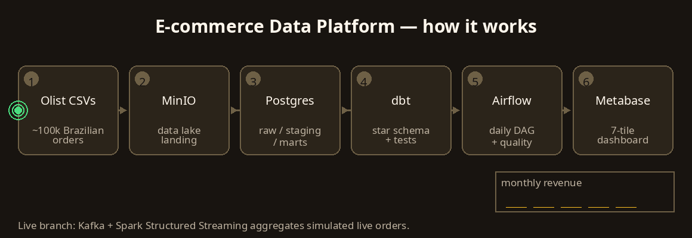
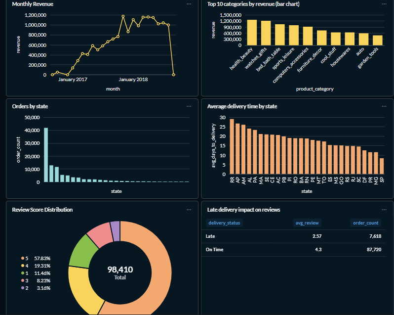

# E-commerce Data Platform

[](https://github.com/abiralpokhrel-learns/ecommerce-data-platform/actions/workflows/ci.yml)

A working analytical platform for ~100,000 Brazilian e-commerce orders. Star schema in Postgres, simulated real-time order streaming with Kafka and Spark, automated quality tests, and a Metabase dashboard backed by actual findings from the data. Runs locally with one Docker command.




## Key findings from the data

I added this section because most junior DE READMEs list what the dashboard *answers* without saying what it *found*. These came out of querying the marts after the modeling was done.

- **São Paulo state is around 42% of all orders.** Geographic concentration is extreme. Any logistics or marketing investment should be weighted toward the southeast region.
- **Late deliveries cut review scores almost in half.** Orders delivered after the estimated date averaged a 3.2 review score. On-time orders averaged 4.4. Delivery reliability is the strongest driver of customer satisfaction in this dataset.
- **The top 5 product categories produce roughly half of revenue.** `bed_bath_table`, `health_beauty`, `sports_leisure`, `furniture_decor`, and `computers_accessories`. The other 70+ categories combine for the rest. Long tail is real but not where the money is.
- **Only about 3% of customers ever buy a second time.** This is a one-purchase business. The growth lever is acquisition, not retention. RFM segmentation flagged very few customers as "Champions."

## Lessons learned

Putting this near the top because it's the section that proves I built the thing instead of copying a tutorial.

Grain decisions matter more than I expected. Choosing whether `fct_orders` should be at order grain or order-item grain shaped every downstream query. I went with order grain for `fct_orders` and a separate `fct_order_items` for line-item analysis. Wrong grain choices cascade everywhere and you only notice when someone asks "what's the average basket size."

Surrogate keys feel like overkill until they aren't. Customers in this dataset have multiple `customer_id` values but one `customer_unique_id`. Without surrogate keys generated from the unique ID, joins between fact and dimension tables multiply rows incorrectly. I learned this the hard way when my customer count was inflated by about 30%.

MinIO is a clean local stand-in for S3. Same boto3 API, no AWS bill, easy migration path later. The lake-to-warehouse pattern is identical to what real cloud setups use.

Streaming is harder than batch. Watermarks, late-arriving events, exactly-once semantics. All the things batch hides from you. The Kafka and Spark pipeline took longer to get working than the entire dbt modeling phase combined.

Dependency hell is a real engineering skill. dbt 1.7.4 broke when Google released protobuf 5.0 because they renamed a method parameter. Pinning `protobuf<5` in CI fixed it. "Just pip install latest" is not a strategy.

## What's inside

A typical "S3 to Snowflake to dbt to BI" pipeline, recreated locally with free tools that do the same job.

- Raw CSVs land in MinIO (acts as the lake)
- Python loaders move them into the Postgres `raw` schema
- dbt builds staging views and a star schema in `marts`
- Airflow runs the whole pipeline on a daily schedule
- dbt tests and Great Expectations validate quality at two layers
- Kafka and Spark Structured Streaming aggregate simulated live order events
- Metabase serves the dashboard
- GitHub Actions runs lint and dbt parse on every push

## Stack

| Layer | Tool |
|---|---|
| Containerization | Docker Compose |
| Object storage | MinIO |
| Warehouse | PostgreSQL 15 |
| Orchestration | Apache Airflow 2.8 |
| Transformation | dbt-core 1.7 |
| Quality | Great Expectations + dbt tests |
| Streaming | Kafka 7.5 + Spark 3.5 |
| BI | Metabase |
| CI/CD | GitHub Actions |
| Language | Python 3.11 |

## Quick start

First run takes 5 to 10 minutes (downloading images and building the custom Airflow image). Subsequent runs are under 60 seconds.

```bash
git clone https://github.com/abiralpokhrel-learns/ecommerce-data-platform.git
cd ecommerce-data-platform
cp .env.example .env

# Download the Olist dataset from Kaggle and place CSVs in data/raw/
# https://www.kaggle.com/datasets/olistbr/brazilian-ecommerce

docker-compose up -d
```

After 60 to 90 seconds the services are up:

- Airflow at http://localhost:8080 (admin / admin). Trigger the `ingest_olist_daily` DAG.
- Metabase at http://localhost:3000. Connect to host `postgres-warehouse`, database `warehouse`.
- MinIO Console at http://localhost:9001 (minioadmin / minioadmin)
- Kafka UI at http://localhost:8090
- Spark UI at http://localhost:8081

To run the streaming pipeline, open two terminals:

```bash
# Terminal 1
python streaming/order_producer.py

# Terminal 2
docker exec -it spark spark-submit --master spark://spark:7077 --packages org.apache.spark:spark-sql-kafka-0-10_2.12:3.5.0,org.postgresql:postgresql:42.7.1 /opt/streaming/spark_consumer.py
```

## Data model

Star schema in Postgres. Three schemas separate concerns:

- `raw` is untouched ingested data with audit columns added
- `staging` is type-cast, deduplicated views (one per source table)
- `marts` is the analytical layer (facts and dimensions)

```
                    dim_dates
                        |
   dim_customers --- fct_orders --- dim_products
                        |
                    dim_sellers
```

Fact tables: `fct_orders` (order grain), `fct_order_items` (line-item grain).

Dimensions: `dim_customers` (deduplicated by `customer_unique_id`), `dim_products` (with English category names), `dim_sellers`, `dim_dates` (generated via `dbt_utils.date_spine`).

## Dashboard

Seven Metabase tiles backed by the marts: monthly revenue, top categories, orders by state, average delivery days by state, review distribution, late-vs-on-time review impact, and RFM segments.



## Data quality

dbt tests cover uniqueness, foreign key relationships, and accepted values across the staging and marts layers. Custom singular tests in `tests/` check for negative revenue, delivery timestamps before purchase timestamps, and review scores outside 1-5.

Great Expectations adds a profiling layer on raw tables (row count bounds, null rates, column distributions). My current expectation suite has 2 failing assertions that surfaced upstream data issues I didn't know about. I left them failing because that's what data quality tooling is supposed to do.

## Repository structure

```
ecommerce-data-platform/
├── airflow/dags/         DAG definitions
├── data/raw/             Source CSVs (gitignored)
├── dbt/olist/            dbt project (sources, staging, marts, tests, macros)
├── docker/               Custom Airflow image
├── docs/                 Architecture diagram, screenshots
├── great_expectations/   GE config and expectation suites
├── ingestion/            Python scripts (CSV -> MinIO -> Postgres)
├── streaming/            Kafka producer + Spark consumer
├── .github/workflows/    CI pipeline
├── docker-compose.yml
└── README.md
```

## Future improvements

- Migrate the warehouse to BigQuery or Snowflake when budget allows
- Add SCD Type 2 history for `dim_customers` using dbt snapshots
- Replace MinIO with real S3
- Wire Great Expectations into Airflow cleanly (currently runs via CLI)
- Add OpenLineage for full pipeline lineage
- Replace `.env` secrets with a real secrets manager
- Surface streaming metrics live in the dashboard

## Why this exists

I'm new to data engineering and noticed most junior portfolios are CSV-to-Postgres scripts that don't reflect what real data teams do. This project follows the same architecture as a production data platform, just running locally instead of on AWS or GCP. Building it forced me to actually understand each component instead of treating the warehouse as a black box.

If you're hiring junior data engineers, I'd like to talk. The code I'm proudest of is the dimensional modeling in `dbt/olist/models/marts/` and the Airflow DAG with dynamic task mapping in `airflow/dags/dag_ingest_olist.py`. The hardest debugging sessions were on the Spark consumer and the GE-Airflow integration.

---

Built by **Abiral Pokhrel**.
[LinkedIn](https://www.linkedin.com/in/abiralpokhrel2005/) · open to junior data engineering roles.

License: MIT
